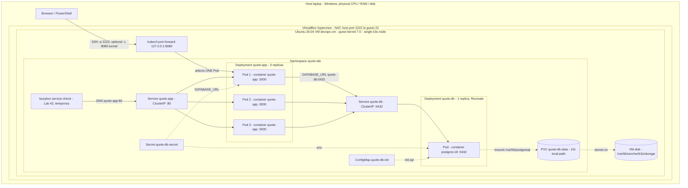

# Lab 52 – From Kubernetes Recovery to Persistent Data

## 1. Lab 42 evidence

The Lab 42 core (both health paths, three Ready replicas, Pod replacement, readiness failure and recovery) and the Lane B liveness extension are documented in [`../42-kubernetes/verification.md`](../42-kubernetes/verification.md).

The app manifest [`../42-kubernetes/deployment.yaml`](../42-kubernetes/deployment.yaml) now also injects `DATABASE_URL` from the Secret.

## 2. PostgreSQL deployment

Files in this directory:

- [`database.yaml`](database.yaml): PVC `quote-db-data`, Deployment `quote-db` (`postgres:18`, 1 replica, `Recreate`), Service `quote-db:5432`.
- [`db-init-configmap.yaml`](db-init-configmap.yaml) and [`init.sql`](init.sql): creates the `quotes` table and three example rows on first start.
- The Secret `quote-db-secret` was created with `kubectl create secret` and is **not committed**. Manifests only reference it (`envFrom.secretRef` for PostgreSQL, `secretKeyRef` for the app's single `DATABASE_URL` key).

```
$ kubectl get pvc quote-db-data
NAME            STATUS   VOLUME                                     CAPACITY   ACCESS MODES   STORAGECLASS
quote-db-data   Bound    pvc-ad7fc52c-b4c7-4739-a244-fc700d472dc1   1Gi        RWO            local-path

$ kubectl get pods -l app=quote-db
NAME                        READY   STATUS    RESTARTS
quote-db-796c9c9d49-s6464   1/1     Running   0

$ kubectl logs deployment/quote-db | grep -E "initdb.d|CREATE TABLE|INSERT"
running /docker-entrypoint-initdb.d/init.sql
CREATE TABLE
INSERT 0 3
```

## 3. Quote insertion and persistence across database Pod replacement

A unique quote was inserted **through the application** (`POST /quotes`) and read back from `GET /` via `kubectl port-forward svc/quote-app 8080:80`:

```
$ quote_marker="res509-$(date +%s)"      # res509-1792398072
$ curl --fail --data-urlencode "author=RES509" --data-urlencode "text=$quote_marker" http://127.0.0.1:8080/quotes
$ curl --fail http://127.0.0.1:8080/ -o /tmp/res509-quotes.html
$ grep -F "$quote_marker" /tmp/res509-quotes.html
    <div>res509-1792398072</div>
```

The database Pod was then replaced while keeping its PVC:

```
$ kubectl rollout restart deployment/quote-db
$ kubectl rollout status deployment/quote-db
deployment "quote-db" successfully rolled out
```

| | Database Pod | PVC |
|---|---|---|
| Before | `quote-db-796c9c9d49-s6464` | `quote-db-data` → `pvc-ad7fc52c-…` (Bound) |
| After | `quote-db-6bd4f9f967-wpkjj` | `quote-db-data` → `pvc-ad7fc52c-…` (Bound) |

```
$ curl --fail http://127.0.0.1:8080/ -o /tmp/res509-quotes-after.html
$ grep -F "$quote_marker" /tmp/res509-quotes-after.html
    <div>res509-1792398072</div>

$ kubectl logs deployment/quote-db | grep -E "Skipping|ready to accept"
PostgreSQL Database directory appears to contain a database; Skipping initialization
database system is ready to accept connections
```

The new Pod mounted the same PVC, found an existing data directory, skipped `init.sql`, and still returned the quote. This proves the data lives on the volume, not in the Pod. With `strategy: Recreate`, the old Pod stopped before the new one started, so the database was briefly unavailable during replacement.

## 4. Architecture of the actual setup

Nested boxes = "runs inside". Solid arrows = traffic paths. Dotted arrows = configuration or storage.



Traffic paths shown separately:

- **Laptop → app (temporary):** SSH into the VM, then `kubectl port-forward svc/quote-app 8080:80`. The port-forward selects **one** Pod; it does not demonstrate Service load balancing.
- **In-cluster client → app (Lab 42):** a temporary `busybox` Pod calls `http://quote-app/health`; cluster DNS and the Service forward the request to a Ready Pod.
- **App → database:** each app Pod connects to `quote-db:5432` (from `DATABASE_URL`); the Service forwards to the single PostgreSQL Pod.

## 5. Boundary notes

**Shared kernel.** The app containers and the PostgreSQL container are isolated processes (namespaces and cgroups) that all share the **Ubuntu VM's guest kernel** (`7.0.0-34-generic`); Kubernetes and containerd manage workloads inside the VM, while the VirtualBox hypervisor provides the VM boundary that separates this kernel from the Windows host.

**Persistence and failure boundary.** An app Pod can be replaced at any time because it keeps no state: the ReplicaSet recreates it from the same image and configuration (Lab 42, section 6). The quote survived the database Pod replacement because PostgreSQL's data directory is on the PVC, which outlives any Pod. But three app replicas and `local-path` storage all live on **one VM and one virtual disk**: losing the VM or its disk would lose every Pod and the database contents, with no replica and no backup. Only what is stored outside the VM, such as the manifests in Git, would survive.

## 6. Main limitation and next action

- **Main limitation:** the database is a single PostgreSQL Pod on node-local storage. Database Pod replacement causes a short outage (`Recreate`), and there is no recovery from VM or disk loss.
- **Next action:** add a scheduled logical backup (`pg_dump`) stored outside the VM, and test a restore into a fresh cluster. Multi-node storage and database replication are future work (Lab 62), not something this teaching cluster provides.
- **Also untested:** `/health` still does not check the database (by design, so a database outage does not restart every app Pod through the liveness probe), and the app's behaviour while the database is briefly unavailable was not measured.
